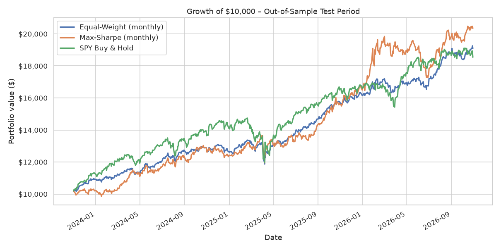
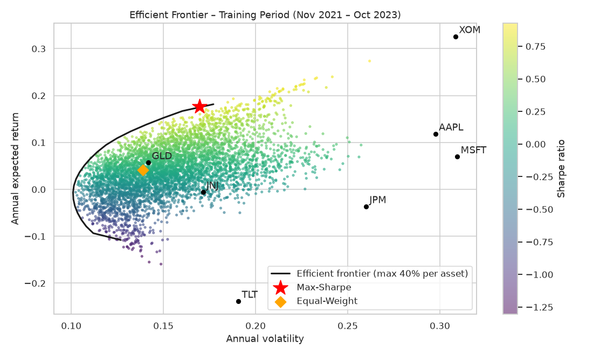
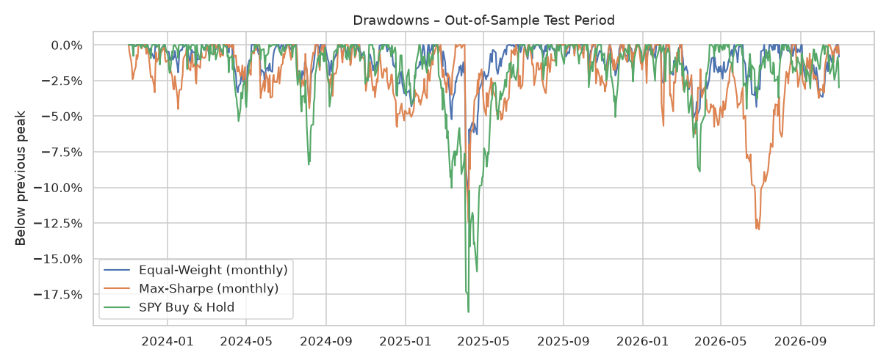
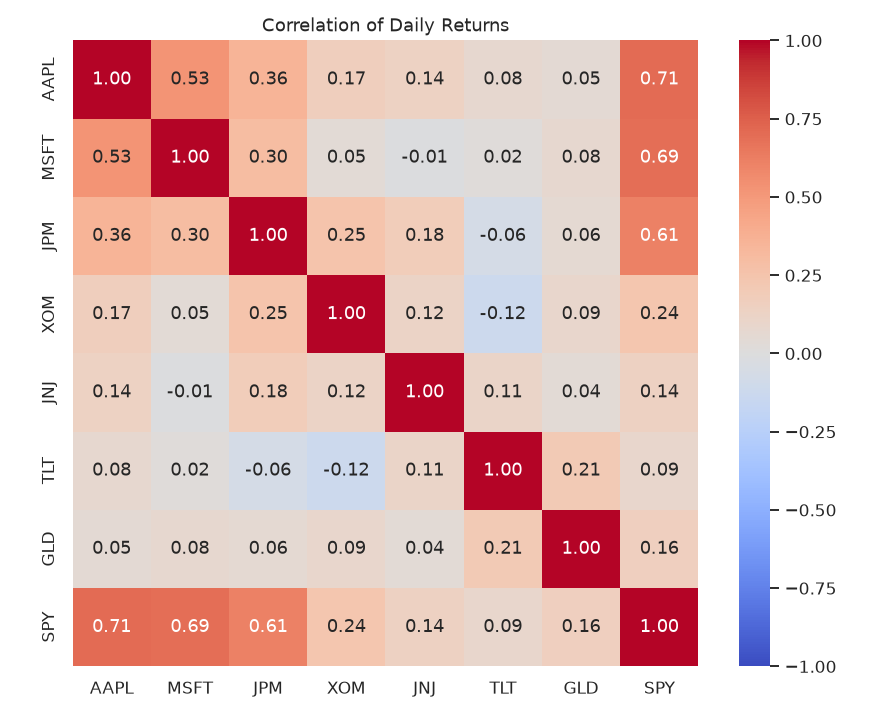

# Stock Portfolio Analysis & Backtesting

A Python project that compares three investment strategies on **~5 years of real daily market data** (Nov 2021 – Oct 2026), using an honest **train / out-of-sample test** split.

| Strategy | Idea |
|---|---|
| **Equal-Weight** | Same weight in each of 7 assets, rebalanced monthly |
| **Max-Sharpe (Mean-Variance)** | Markowitz optimisation (`scipy.optimize`) on a 2-year training window, then held fixed and rebalanced monthly on unseen data |
| **SPY Buy & Hold** | S&P 500 ETF benchmark |

**Universe:** AAPL, MSFT (tech) · JPM (banking) · XOM (energy) · JNJ (healthcare) · TLT (20+ yr Treasuries) · GLD (gold). Benchmark: SPY.

## Key Results (out-of-sample test: Nov 2023 – Oct 2026)

| Strategy | Annual Return (CAGR) | Annual Volatility | Sharpe Ratio | Max Drawdown | Total Return |
|---|---:|---:|---:|---:|---:|
| Equal-Weight (monthly) | 24.24% | 10.35% | **1.73** | **-11.22%** | 90.94% |
| Max-Sharpe (monthly) | **26.92%** | 14.41% | 1.43 | -12.96% | **103.47%** |
| SPY Buy & Hold | 23.02% | 15.23% | 1.15 | -18.76% | 85.40% |

*Sharpe uses the average 13-week T-bill yield over the test period (4.32%). Includes 5 bps transaction cost per rebalance.*

**Max-Sharpe weights (estimated on Nov 2021 – Oct 2023, 40% cap per asset):** XOM 40%, GLD 40%, AAPL 20%, others 0%.

### Takeaways
- **Diversification works:** with low correlations between stocks, Treasuries and gold, the simple equal-weight portfolio had ~1/3 less volatility than SPY, a much smaller worst drawdown (-11% vs -19%), and the best risk-adjusted return (Sharpe 1.73 vs 1.15).
- **Optimisation is a double-edged sword:** the Max-Sharpe portfolio earned the highest return, but it was concentrated in just three assets, so it took more risk and had a lower Sharpe than equal-weight. Weights estimated with hindsight on the test period look very different, which shows how sensitive mean-variance optimisation is to its inputs.
- **Test out-of-sample:** every number above comes from data the optimiser never saw.

## Charts

**Growth of $10,000 (out-of-sample)**


**Efficient frontier (training period)**


**Drawdowns**


**Correlation of daily returns**


More charts: [`images/`](images/) (normalised prices, per-asset cumulative returns, rolling 6-month Sharpe).

## Methods
1. **Data** – adjusted daily close prices (splits & dividends included) from Yahoo Finance via `yfinance`, cached to `data/` (one CSV per ticker/date combination).
2. **Exploration** – daily & annualised returns, volatility, calendar-year returns, correlation heatmap, cumulative returns.
3. **Optimisation** – long-only, fully invested, max 40% per asset. Maximise Sharpe ratio with SLSQP; efficient frontier by minimising volatility for a range of target returns; 5,000 random portfolios for comparison.
4. **Backtest** – weights drift with prices during the month and are rebalanced to target at each month end (5 bps cost on turnover).
5. **Metrics** – CAGR, annualised volatility, Sharpe ratio, maximum drawdown, total return, rolling Sharpe.

## Project Structure
```
portfolio-backtest/
├── portfolio_analysis.ipynb   # main analysis (executed, with outputs)
├── src/
│   ├── data.py        # price & risk-free rate download (yfinance) + caching
│   ├── metrics.py     # CAGR, volatility, Sharpe, drawdown, summary table
│   ├── optimize.py    # max-Sharpe weights, efficient frontier, random portfolios
│   └── backtest.py    # monthly-rebalanced backtester, buy & hold
├── images/            # saved charts + summary_metrics.csv
├── requirements.txt
└── README.md
```

## How to Run
```bash
git clone https://github.com/YinghsuanLiu-Data/portfolio-backtest.git
cd portfolio-backtest
python -m venv .venv && source .venv/bin/activate   # Windows: .venv\Scripts\activate
pip install -r requirements.txt
jupyter notebook portfolio_analysis.ipynb
```
Run all cells. The first run downloads data from Yahoo Finance; later runs reuse the cached CSV for the same tickers and dates; changing them downloads fresh data automatically. Change `ASSETS`, dates, `MAX_WEIGHT` or `COST_BPS` in the parameters cell to try your own scenarios.

## Limitations & Next Steps
- Historical mean returns are noisy estimates; try Ledoit-Wolf covariance shrinkage or a minimum-variance portfolio.
- Walk-forward optimisation (re-estimate weights every year).
- Broader universe (international equities, REITs), taxes and slippage.

*For educational purposes only — not investment advice.*
